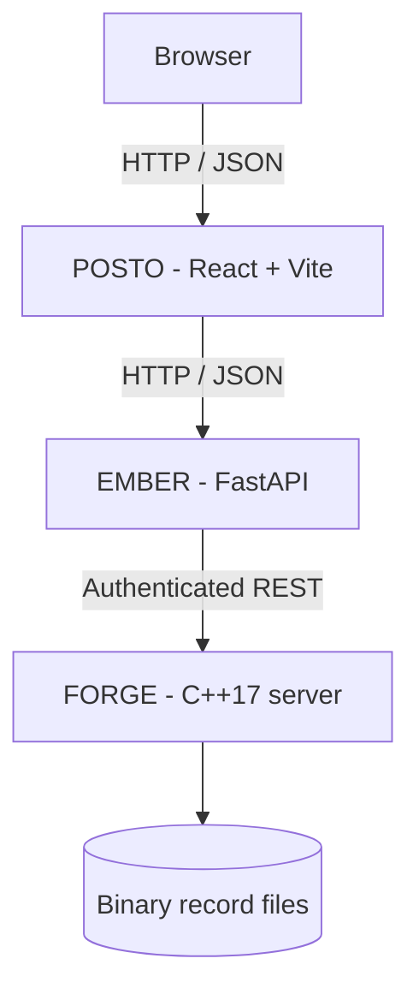

# FORGE + EMBER + POSTO

A full-stack email application built around a small custom C++ database engine.

## Architecture



- **FORGE** owns persistent user, message, and recipient records; authentication; indexing; and the restricted read-only query endpoint.
- **EMBER** is the application API and communicates with FORGE over HTTP. It does not maintain a second message database.
- **POSTO** is the React/Vite mail client and communicates only with EMBER.

## Repository layout

| Path | Purpose |
|---|---|
| `forge/` | C++ database engine, HTTP server, CLI, and CMake tests |
| `backend/` | FastAPI application and FORGE HTTP client |
| `ember/posto-—-elegant-mail-client/` | React/Vite frontend |
| `docs/` | Audit, implementation plan, and technical documentation |
| `start-ember.sh` | Local three-service development launcher |
| `docker-compose.yml` | Containerized local stack |

## Run locally

Prerequisites: C++17 compiler, CMake, libargon2 development files, Python 3.11+, uv, Node.js 22.12+, and npm.

```bash
bash start-ember.sh
```

The launcher installs dependencies, builds and tests FORGE, starts FORGE and EMBER, checks the POSTO TypeScript project, and starts Vite.

- POSTO: http://localhost:3000
- EMBER API docs: http://127.0.0.1:8000/docs
- EMBER health: http://127.0.0.1:8000/health
- FORGE health: http://127.0.0.1:8080/health

Set `INSTALL_SYSTEM_DEPS=0` to skip the launcher's apt package installation when dependencies are already installed. Local FORGE data is stored in `forge/data/`.

## Run with Docker Compose

```bash
cp .env.example .env
docker compose up --build
```

Open http://localhost:3000. Compose publishes FORGE on 8080 and EMBER on 8000; POSTO is served on 3000. FORGE data persists in the `forge-data` named volume.

For the browser-facing API URL, `VITE_API_BASE_URL` must point to the host-published EMBER port (default: `http://localhost:8000/api/v1`). Inside the Compose network, EMBER reaches FORGE at `http://forge:8080`.

## Tests

FORGE:

```bash
cmake -S forge -B build/forge
cmake --build build/forge --parallel 2
ctest --test-dir build/forge --output-on-failure
bash forge/tests/api_smoke.sh
```

EMBER:

```bash
cd backend
uv sync --group dev
uv run ruff check .
uv run pytest -q
```

POSTO:

```bash
cd ember/posto-—-elegant-mail-client
npm ci
npm run lint
npm run build
```

A full-stack GitHub Actions workflow is defined in `.github/workflows/full-stack-ci.yml`. Build/test and Docker execution must be verified in the target environment; do not infer success from the presence of workflow or Docker files.

## Current functionality

- Registration, login, logout, and current-user lookup.
- Authenticated message sending with TO, CC, and BCC recipient types.
- Inbox, sent, starred, and trash views.
- Read/unread, star, trash, restore, and permanent-delete UI actions.
- Mailbox search, sorting, and offset-based load-more pagination.
- BCC recipient visibility filtering in EMBER responses.

## Known limitations under active implementation

- Per-user read/star/trash state is now stored in FORGE format version 2, with a startup migration from legacy message-level flags. This change and its tests are committed but have not yet been run in this environment.
- Permanent deletion currently removes the requesting user's mailbox-state row. Physical compaction of shared message/recipient records after the final participant deletes their copy is still outstanding.
- Multi-record message creation currently uses best-effort rollback, not a crash-safe write-ahead log.
- Draft persistence, reply-all/threading, batch message enrichment, and full end-to-end coverage remain outstanding.
- Attachments and tag/wax-seal metadata are not persisted by the current FORGE schema.
- Newly added format migration, per-user state, BCC, pagination, CI, and Docker changes have not yet been verified by running their test/build workflows in this environment.

See [the implementation audit](docs/IMPLEMENTATION_AUDIT.md) and [implementation plan](docs/IMPLEMENTATION_PLAN.md) for the current status. This project is a compact educational database/application stack, not a production email service.
