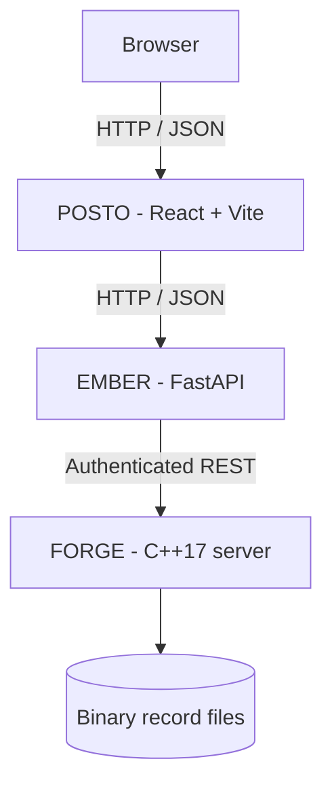

# FORGE + EMBER + POSTO

A full-stack email application built around a small custom C++ database engine.

## Architecture



- **FORGE** owns persistent user, message, and recipient records; authentication; indexing; and the restricted read-only query endpoint.
- **EMBER** is the application API and communicates with FORGE over HTTP. It does not maintain a second message database.
- **POSTO** is the React/Vite mail client and communicates only with EMBER.

## Repository layout

| Path | Purpose |
|---|---|
| `forge/` | C++ database engine, HTTP server, CLI, and CMake tests |
| `backend/` | FastAPI application and FORGE HTTP client |
| `ember/posto-—-elegant-mail-client/` | React/Vite frontend |
| `docs/` | Audit, implementation plan, and technical documentation |
| `start-ember.sh` | Local three-service development launcher |
| `docker-compose.yml` | Containerized local stack |

## Run locally

Prerequisites: C++17 compiler, CMake, libargon2 development files, Python 3.11+, uv, Node.js 22.12+, and npm.

```bash
bash start-ember.sh
```

The launcher installs dependencies, builds and tests FORGE, starts FORGE and EMBER, checks the POSTO TypeScript project, and starts Vite.

- POSTO: http://localhost:3000
- EMBER API docs: http://127.0.0.1:8000/docs
- EMBER health: http://127.0.0.1:8000/health
- FORGE health: http://127.0.0.1:8080/health

Set `INSTALL_SYSTEM_DEPS=0` to skip the launcher's apt package installation when dependencies are already installed. Local FORGE data is stored in `forge/data/`.

## Run with Docker Compose

```bash
cp .env.example .env
docker compose up --build
```

Open http://localhost:3000. Compose publishes FORGE on 8080 and EMBER on 8000; POSTO is served on 3000. FORGE data persists in the `forge-data` named volume.

For the browser-facing API URL, `VITE_API_BASE_URL` must point to the host-published EMBER port (default: `http://localhost:8000/api/v1`). Inside the Compose network, EMBER reaches FORGE at `http://forge:8080`.

## Tests

FORGE:

```bash
cmake -S forge -B build/forge
cmake --build build/forge --parallel 2
ctest --test-dir build/forge --output-on-failure
bash forge/tests/api_smoke.sh
```

EMBER:

```bash
cd backend
uv sync --group dev
uv run ruff check .
uv run pytest -q
```

POSTO:

```bash
cd ember/posto-—-elegant-mail-client
npm ci
npm run lint
npm run build
```

The full-stack GitHub Actions workflow in `.github/workflows/full-stack-ci.yml` verifies FORGE build/unit/API smoke, EMBER lint/tests, POSTO typecheck/build, and Docker Compose config/image builds. Latest verified run: [run 145](https://github.com/SumedhAnupSupe/forge-ember/actions/runs/43996583436).

## Current functionality

- Registration, login, logout, and current-user lookup.
- Authenticated message sending with TO, CC, and BCC recipient types.
- Inbox, sent, starred, and trash views.
- Read/unread, star, trash, restore, and permanent-delete UI actions.
- Mailbox search, sorting, and offset-based load-more pagination.
- BCC recipient visibility filtering in both FORGE and EMBER responses.
- Independent read/star/trash state per participant, stored in `mailbox_states.dat`.
- Batched sender/recipient envelopes returned by FORGE with each message.

## Known limitations under active implementation

- Permanent deletion removes the requesting user's mailbox-state row. Physical compaction of shared message and recipient records after the final participant removes their copy is still outstanding.
- Message plus recipient creation uses a checksummed, replayable write-ahead journal. It uses stream flush and atomic rename but does not call OS-level `fsync`, and the journal does not cover every update/delete operation.
- FORGE enforces 24-hour sessions and a five-failure/15-minute login throttle per normalized email + remote address. POSTO still needs clearer session-expiry UX.
- Draft persistence, reply/reply-all/forward, and thread APIs/UI remain outstanding.
- More concurrency/failure-injection tests, frontend component tests, measured benchmarks, and a reproducible demo/report remain outstanding.
- Attachments and tag/wax-seal metadata are not persisted by the current FORGE schema; unsupported UI affordances were removed.

See [the implementation audit](docs/IMPLEMENTATION_AUDIT.md) and [implementation plan](docs/IMPLEMENTATION_PLAN.md) for the current status. This project is a compact educational database/application stack, not a production email service.
