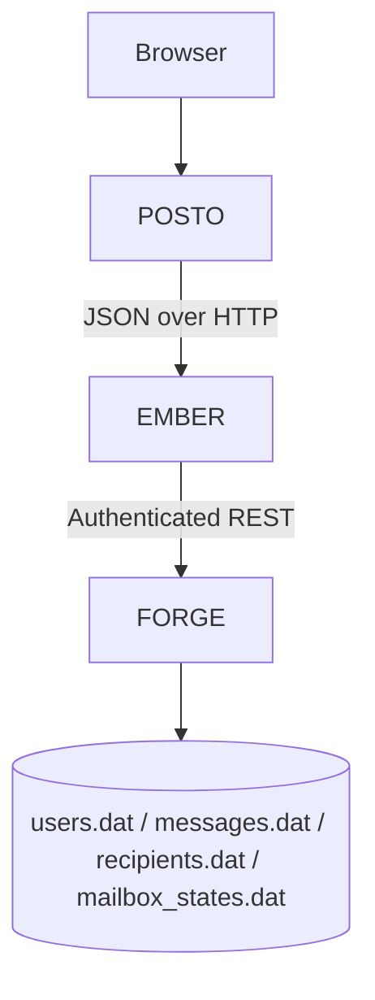

# Architecture

## Component boundaries

- POSTO is a browser client. It must not call FORGE directly.
- EMBER owns request validation, application-level mailbox composition, and response shaping. It uses a single FORGE HTTP client.
- FORGE owns the canonical user, message, recipient, authentication/session, and binary persistence implementation.

## Local ports

| Service | Port | Health / docs |
|---|---:|---|
| POSTO (Vite) | 3000 | http://localhost:3000 |
| EMBER (FastAPI) | 8000 | `/health`, `/docs` |
| FORGE (C++ HTTP) | 8080 | `/health` |

## Request lifecycle

1. The user signs in through POSTO; credentials are sent to EMBER.
2. EMBER delegates registration/login/session lookup to FORGE.
3. POSTO sends mailbox requests with the bearer token to EMBER.
4. EMBER forwards the token and data to FORGE, then enriches records with sender/recipient details.
5. FORGE validates the session and authorizes message operations against the authenticated user.

## Important invariants

- FORGE remains the source of truth; EMBER must not duplicate user/message persistence.
- The authenticated user ID is derived from the FORGE session, never accepted from POSTO as authority.
- FORGE returns a viewer-scoped sender/recipient envelope with each message: senders see the full envelope, ordinary recipients see TO/CC, and each BCC recipient sees only their own BCC entry. EMBER applies a second BCC filter as defense in depth.
- Read/star/trash state is stored independently per `(message_id, user_id)` in `mailbox_states.dat`; legacy message flags are retained for migration compatibility.
- Message plus recipient creation is journaled and replayed idempotently on startup. The journal does not yet cover all update/delete operations and does not call OS-level `fsync`.
- Permanent removal deletes the caller's mailbox-state row. When no participant state remains, FORGE replays a purge journal to compact the message, recipient, and mailbox-state files.

## Container networking

Compose exposes browser-facing services on localhost. Inside the Compose network, EMBER uses `http://forge:8080`; POSTO is built with the host-visible EMBER URL because the browser, not the Nginx container, makes API calls.
